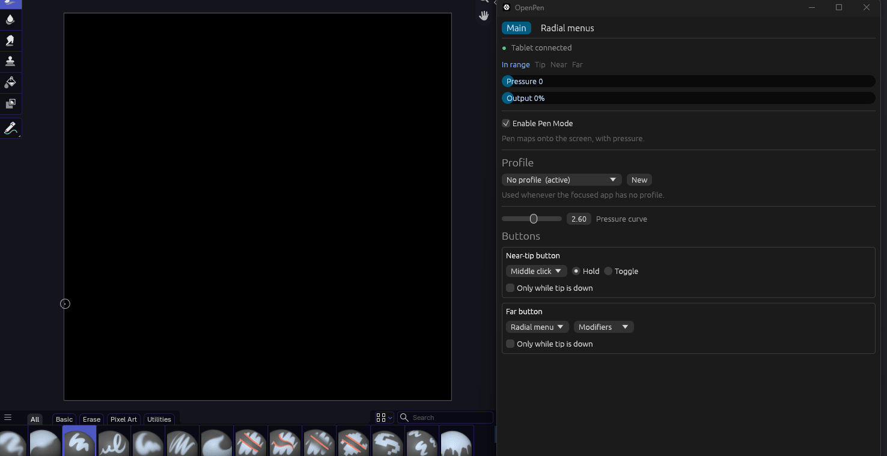

# OpenPen

A driver-free, Rust-based replacement for the Wacom software, mostly made for myself and for the **Wacom One (CTL-672)** tablet.



## Why

The official Wacom software is unstable and missing things I wanted, mainly a radial menu that can *hold* modifier keys (e.g. keep Shift held while middle-dragging to pan in Blender). OpenPen talks to the tablet directly, so the Wacom driver and Wacom Center can be uninstalled entirely.

## Features

- **Pen mode:** absolute pen input with pressure, mapped to the main monitor. Turn it off for relative, mouse-like movement.
- **Pressure curve:** 1–4, so full force still reaches 100% but light presses give less.
- **Button mapping** for both pen buttons: mouse clicks, key combos (with key capture), or a radial menu. Hold or Toggle, optionally only while the tip is down.
- **Per-app profiles:** bindings switch automatically based on the focused app (e.g. `blender.exe`), with "No profile" as the fallback.
- **Radial menus:** separate named menus with 2–8 slices and a live clickable editor. Hold a pen button to show the ring, point, release to pick. Slices are **Tap** (fires once) or **Toggle (stays held)**, and active toggles show in purple.
- **Tray icon:** minimizing hides OpenPen to the system tray.
- **Self-contained:** settings live in a `SaveData` folder next to the exe.

## How it works

The tablet's own USB interface is mostly vendor-defined, which is why Windows needs Wacom's driver to treat it as a pen. Its protocol was worked out from USB captures (USBPcap + Wireshark):

- Sending HID feature report `0x02 = [02]` switches the tablet from its built-in relative-mouse mode into pen-report mode.
- It then sends 10-byte reports (ID `0x02`):

| Bytes | Meaning |
|---|---|
| 1 | status: `0x40` in range, `0x20` close hover, `0x01` tip, `0x02` near-tip button, `0x04` far button |
| 2–3 | X, little-endian, 0–21600 |
| 4–5 | Y, little-endian, 0–13500 |
| 6–7 | pressure, 0–2047 |
| 8–9 | hover height |

OpenPen reads these with `hidapi` and feeds Windows through synthetic pen injection (`InjectSyntheticPointerInput`) plus `SendInput` for mouse buttons and keys. The UI is `egui`/`eframe`.

## Running

Requirements: Windows 10/11, a Wacom One CTL-672, and the Rust toolchain.

1. Uninstall the Wacom driver/software (it hides the tablet's raw interface), reboot, and replug the tablet.
2. Build and run:

   ```
   cargo run --release
   ```

The tablet only works as a pen while OpenPen is running. Replug it after closing OpenPen to get its built-in mouse mode back.

Other binaries used while reverse engineering: `cargo run --bin reader` prints decoded pen reports, and `cargo run --bin penprobe` logs raw HID and mouse events.

## Notes

- Only tested on my own CTL-672. Other Wacom models likely use different report layouts.
- Not affiliated with Wacom.
